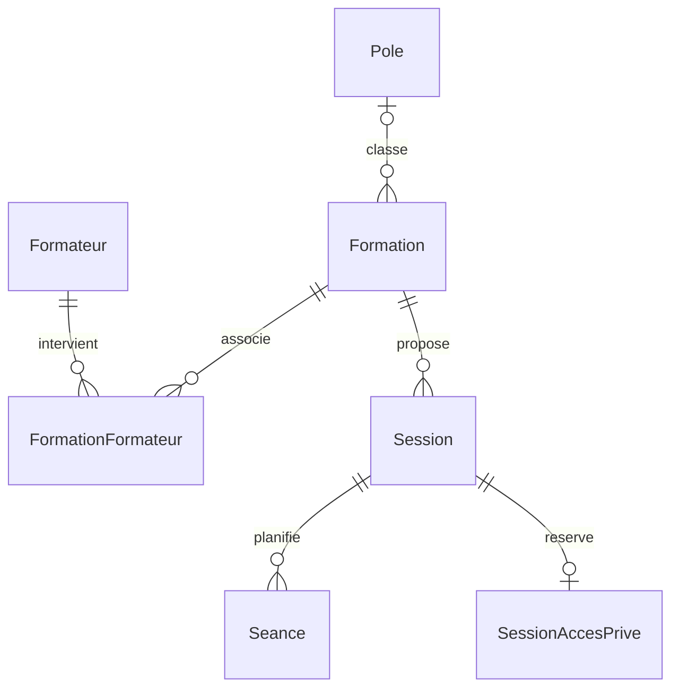

# Catalogue CMH Academy : modèle et migration à relire

État du 24 octobre 2026. **Migration appliquée à la base locale de développement**,
après essais isolés et sauvegarde restaurée : voir
[le compte rendu d'application](catalogue-application-locale.md) et
[les essais isolés](catalogue-tests.md). Aucune donnée métier modifiée.
Aucune nouvelle dépendance ou route Express.

## 1. Existant inspecté avant migration

Inspection réelle de PostgreSQL, dans une transaction `READ ONLY`, avec
`information_schema`, `pg_constraint` et `pg_indexes`, puis comparaison aux
fichiers Prisma. PostgreSQL **18.6**, schéma **public**, rôle **cmh_app**.

Une seule table métier : `public."Formation"`, actuellement **0 ligne**.

| Colonne | Type PostgreSQL réel | Nullable | Valeur par défaut en base |
| --- | --- | --- | --- |
| id | TEXT, clé primaire | non | aucune |
| titre | TEXT | non | aucune |
| description | TEXT | non | chaîne vide |
| publiee | BOOLEAN | non | false |
| createdAt | TIMESTAMP(3) sans fuseau | non | CURRENT_TIMESTAMP |
| updatedAt | TIMESTAMP(3) sans fuseau | non | aucune |

L'identifiant `cuid()` et la mise à jour de `updatedAt` sont assurés par Prisma,
pas par un défaut SQL ou un trigger. La migration conserve cette convention
pour les nouvelles entités, ainsi que les noms PascalCase/camelCase entre
guillemets et les identifiants TEXT. Les dates historiques ne sont pas converties.

Pas de clé étrangère existante, ni d'index autre que `Formation_pkey`.
La table technique `_prisma_migrations` contient une migration terminée,
`20261022174525_creation_formations`, sans retour arrière enregistré.

`cmh_app` possède les tables existantes et dispose actuellement de droits
d'écriture. Cette étape ne change aucun privilège. Avant mise en ligne,
séparer les droits de migration des droits nécessaires au backend et protéger
toutes les futures fonctions d'administration.

L'API actuelle utilise déjà un `select` explicite sur `id`, `titre`,
`description`, avec `where: { publiee: true }`. Le frontend ne reçoit aucun
identifiant PostgreSQL et utilise le proxy `/api` de Vite.

## 2. Modèle cible



### Pôles et formateurs

`Pole` : id, titre, slug unique, description et horodatages. Les domaines sont
des lignes administrables, pas un enum : commerce du cheval, bien-être du
cheval, développement du cavalier, puis d'autres pôles peuvent être créés sans
changer le schéma. **Aucun de ces pôles n'est inséré par cette migration.**
Les pôles statiques actuellement affichés dans React ne sont pas remplacés ici.

Une formation appartient à **zéro ou un pôle** pendant sa préparation ; un pôle
peut contenir plusieurs formations. C'est un classement principal unique,
choisi pour ce modèle. `poleId` reste nullable pour conserver les anciennes
fiches sans leur attribuer arbitrairement un domaine.

`Formateur` : id, nom d'affichage public complet, biographie et horodatages.
Ce n'est ni un compte utilisateur, ni un dossier administratif.
`FormationFormateur` réalise la relation plusieurs-à-plusieurs : un formateur
peut intervenir sur plusieurs formations et inversement. La clé primaire
composée empêche d'associer deux fois le même formateur à une formation.
L'affectation par session ou séance n'est pas ajoutée à cette étape.

### Fiche formation : contenu stable et tarif de référence

Les six colonnes historiques restent inchangées. Ajouts :

| Champ | Représentation / sens |
| --- | --- |
| slug | TEXT nullable, unique lorsqu'il est renseigné |
| resume | TEXT, présentation courte |
| description | TEXT existant, présentation détaillée |
| objectifs, programme | TEXT, contenu pédagogique |
| publicVise, prerequis | TEXT, destinataires et conditions d'accès |
| dureeMinutes | INTEGER positif ou NULL, durée pédagogique annoncée |
| format | enum WEBINAIRE / PRESENTIEL / HYBRIDE, ou NULL |
| tarif | DECIMAL(12,2) non négatif ou NULL, montant de référence |
| devise | CHAR(3), code monétaire en majuscules, EUR par défaut |
| financement | TEXT, informations de financement |
| parcoursDocumentaire | BOOLEAN, false par défaut |
| poleId | TEXT nullable, référence au pôle |

Les contenus nouveaux valent `''` par défaut et peuvent être préparés
progressivement. Le programme est un texte, pas encore une collection de modules.
Les slugs renseignés utilisent lettres ASCII minuscules, chiffres et tirets,
sans tiret initial/final ni tirets consécutifs. Les espaces de noms des slugs
des pôles et formations sont distincts.

`publiee` reste la **seule source du statut de publication** : false = brouillon,
true = publiée. Aucun statut concurrent. Pas de contrainte de complétude sur
les fiches déjà publiées : elle casserait la compatibilité. La future action
administrative de publication devra notamment vérifier titre, slug, pôle,
contenus pédagogiques, durée et format, selon les règles validées avec Camille.

`tarif = NULL` signifie non renseigné / sur demande ; `0.00` signifie gratuit.
La précision maximale est 9 999 999 999,99 unités et le montant ne peut être
ni négatif ni NaN. Aucun Float ni type PostgreSQL MONEY. Les opérations futures
devront garder `Prisma.Decimal` et sérialiser les montants en chaînes décimales,
sans passage par un nombre JavaScript pour les calculs. La base contrôle la
forme du code monétaire ; sa validité métier sera contrôlée à la saisie.
Le modèle est prévu ici pour des devises à deux décimales, notamment l'euro.
La base fiscale HT/TTC et les éventuels tarifs spécifiques à une session
restent à définir avant une future fonction commerciale ; aucun paiement ajouté.

`parcoursDocumentaire` est un réglage indépendant du format : un webinaire
peut l'activer et une formation en présentiel peut le désactiver. Ce booléen
ne crée aucun document, inscription, paiement ou processus de signature.

### Sessions : organisation d'une occurrence

`Session` : id, formationId obligatoire, capacité positive ou NULL si non
renseignée, lieu optionnel, modalités pratiques publiques, fuseauHoraire
(`Europe/Paris` par défaut) et horodatages. Une formation possède zéro à
plusieurs sessions. Le format pédagogique est porté par la formation ; le lieu
et les modalités d'une occurrence sont portés par sa session.

La capacité est une limite totale, pas un nombre de places restantes. Aucun
compteur de réservation ni inscription n'est créé. Les modalités pratiques
publiques décrivent par exemple les prérequis matériels, sans lien d'accès
confidentiel. Le fuseau doit être un identifiant IANA valide à la future saisie ;
le CHECK SQL vérifie seulement qu'il n'est pas vide.

### Séances : calendrier réel

`Seance` : id, sessionId obligatoire, debut et fin en **TIMESTAMPTZ(3)** et
horodatages. Chaque fin doit être strictement postérieure au début et les deux
instants doivent être finis. Un index `(sessionId, debut)` facilite le calendrier.

Exemple : une formation de **840 minutes (14 h)** peut proposer une session
comprenant **quatre séances de 210 minutes (3 h 30)**, chacune avec ses vrais
instants de début et fin. Cet exemple ne fait l'objet d'aucune insertion.
Le début et la fin d'une session se déduisent de ses séances, sans dates
redondantes stockées sur Session. PostgreSQL conserve les instants ;
`Session.fuseauHoraire` sert à afficher et saisir les heures locales, notamment
aux changements d'heure.

Une session peut rester sans séance lors de sa préparation. L'application devra
ultérieurement contrôler sa complétude avant de l'ouvrir, les chevauchements
et l'adéquation entre durée annoncée et somme des durées des séances. Ces règles
inter-lignes ne sont pas simulées par des CHECK incomplets. Pas de moteur de
récurrence ni de génération automatique de rendez-vous à cette étape.

### Accès confidentiels et API

`SessionAccesPrive` est une table distincte, optionnelle, liée en un-à-un à
Session par sa clé primaire `sessionId`. Elle contient `lienVisioconference`
et les horodatages. Une même salle peut servir aux différentes séances de la
session. Aucun lien privé n'est stocké dans les champs publics du catalogue.

**Ne jamais exposer `SessionAccesPrive`, ni sa relation `accesPrive`, dans une
API publique.** La séparation ne remplace pas une autorisation : toute future
lecture interne devra être authentifiée et autorisée. Aucun endpoint privé
n'est créé aujourd'hui. Aucun GRANT public n'est ajouté par le SQL.

`GET /api/formations` reste inchangé :

```js
where: { publiee: true },
select: { id: true, titre: true, description: true },
orderBy: [{ titre: 'asc' }, { id: 'asc' }],
```

Réponse conservée : `{ "formations": [{ "id": "…", "titre": "…", "description": "…" }] }`.
Ni nouveau champ ni relation n'est automatiquement chargé par ce `select`.
Les futures routes publiques utiliseront aussi une liste explicite de champs ;
ne pas sérialiser une session entière ou ajouter `include: { accesPrive: true }`.
Les futures écritures devront empêcher la saisie de liens privés dans les
textes destinés au public. Le frontend reste inchangé pour cette étape.

### Intégrité et suppressions

Les clés étrangères empêchent les références inexistantes. La suppression
d'un pôle utilisé, d'une formation ayant des sessions, ou d'une session ayant
des séances est refusée (`RESTRICT`). Les cascades de suppression ne concernent
que les associations FormationFormateur et l'accès privé d'une session.
Elles ne suppriment jamais une formation, un formateur, une session ou une séance
par effet indirect. Les identifiants restent normalement immuables ; les FK
conservent `ON UPDATE CASCADE` pour rester cohérentes.

## 3. Fichiers préparés

- `prisma/schema.prisma` : modèle cible, en avance sur la base tant que la migration n'est pas appliquée.
- `prisma/migrations/20261024150000_catalogue/migration.sql` : montée transactionnelle, uniquement DDL.
- `prisma/rollbacks/20261024150000_catalogue.sql` : retour arrière protégé, hors du répertoire de montée.
- `prisma/rollbacks/20261024150000_schema-avant.prisma` : modèle antérieur pour un retour arrière.

Les nouveaux champs nullables ou dotés de valeurs par défaut préservent les
lignes existantes ; les valeurs historiques et `publiee` ne sont pas réécrits.
Le SQL ajoute des CHECK (montants, durée, capacité, slugs, dates) que le modèle
Prisma ne représente pas. Ces contraintes doivent être conservées lors des
futures migrations SQL ; `prisma validate` ne les valide pas.

## 4. Application ultérieure — ne pas lancer maintenant

1. Relire le SQL et sauvegarder la base avec l'outillage PostgreSQL habituel,
   dans un emplacement privé hors du dépôt. Vérifier que la sauvegarde se restaure
   sur une base isolée. Garder aussi la version antérieure du code et du client Prisma.
2. Prévoir une interruption des écritures et une fenêtre courte de maintenance :
   les ALTER TABLE prennent des verrous. Le SQL abandonne si le verrou n'est pas
   obtenu en 5 secondes ou si une instruction dépasse 60 secondes.
3. Utiliser une configuration locale privée avec les droits DDL nécessaires,
   ciblant la bonne base. Ne jamais mettre d'URL ni de mot de passe dans les
   commandes copiées, les sorties ou le frontend. Le rôle applicatif courant
   est propriétaire aujourd'hui ; une séparation des rôles reste à prévoir.
4. Dans `backend`, vérifier l'état avec les commandes en lecture seule :

   ```powershell
   npx --no-install prisma validate
   npx --no-install prisma migrate status
   npx --no-install prisma migrate diff --from-config-datasource --to-schema prisma/schema.prisma --script
   ```

   Attendu : migration initiale terminée, seule `20261024150000_catalogue`
   en attente, diff correspondant aux ajouts préparés. `migrate status` peut
   retourner un code non nul tant qu'une migration est en attente. Arrêter en
   cas de dérive ou de migration échouée ; ne pas modifier une migration déjà appliquée.

5. Après validation explicite, appliquer **uniquement les migrations relues** :

   ```powershell
   npx --no-install prisma migrate deploy
   # Seulement si deploy a réussi :
   npx --no-install prisma generate
   ```

   Malgré son nom, `migrate deploy` applique les migrations à la base configurée ;
   il ne publie pas le site. Il applique toutes les migrations en attente :
   vérifier leur liste avant exécution. Ne pas utiliser `migrate dev`, `reset`,
   `db push` ni seed sur la base existante.

6. Redémarrer Express après génération du client. Vérifier les tables,
   contraintes et index, les volumes historiques, l'état Prisma et le même
   `GET /api/formations`. Dans une base de test isolée, vérifier ensuite les
   rejets (FK invalides, slugs dupliqués, montant négatif/NaN, capacité/durée
   non positives, fin avant début) et la non-exposition des liens privés.
   Ne pas insérer ces cas de test dans la base existante.

La transaction SQL rend la montée atomique. En cas d'échec, lire le diagnostic
localement sans le diffuser. Si Prisma enregistre une migration échouée,
confirmer d'abord que le DDL a intégralement été annulé, puis seulement marquer
cette tentative comme annulée avant une nouvelle tentative :

```powershell
npx --no-install prisma migrate resolve --rolled-back 20261024150000_catalogue
```

Cette commande est réservée à une **tentative échouée**, pas à une migration
terminée avec succès. Ne jamais la lancer sans examiner l'état réel.

## 5. Retour arrière ultérieur

**Avant application**, aucun retour arrière SQL n'est nécessaire. Retirer la
migration en attente et rétablir le modèle antérieur suffit, après vérification
qu'aucune base partagée ne l'a appliquée.

**Après application réussie**, privilégier une migration compensatrice versionnée
afin de conserver un historique Prisma exact. Le SQL fourni commence par verrouiller
les tables et refuse toute suppression si les nouvelles tables contiennent des
lignes ou si une nouvelle colonne de Formation contient autre chose que son état
initial. Les six colonnes historiques sont préservées, même si leurs valeurs ont
évolué depuis. Il n'y a ni suppression de lignes, ni `DROP ... CASCADE`.

Dans une fenêtre de maintenance, après sauvegarde et revue, depuis `backend`,
et **uniquement si aucune migration postérieure ne dépend du catalogue** :

```powershell
# Exemple de version pour une compensation immédiate ; choisir un horodatage
# ultérieur à la dernière migration du projet si nécessaire.
New-Item -ItemType Directory -Path prisma/migrations/20261024160000_annulation_catalogue
Copy-Item -LiteralPath prisma/rollbacks/20261024150000_catalogue.sql -Destination prisma/migrations/20261024160000_annulation_catalogue/migration.sql
Copy-Item -LiteralPath prisma/rollbacks/20261024150000_schema-avant.prisma -Destination prisma/schema.prisma
npx --no-install prisma validate
npx --no-install prisma migrate status
# Après revue de la seule nouvelle migration en attente :
npx --no-install prisma migrate deploy
# Seulement si deploy a réussi :
npx --no-install prisma generate
```

Redémarrer Express et vérifier à nouveau le catalogue public. Versionner la
compensation avec le schéma rétabli ; conserver la migration de montée et ne
pas modifier manuellement `_prisma_migrations`. Ne pas exécuter directement le
fichier down avec `prisma db execute` après une montée réussie : cela laisserait
l'historique en décalage avec la base.

Si le garde-fou refuse le retour arrière, ne pas le retirer : garder le schéma
additif avec l'ancienne API (qui reste compatible) et préparer une migration
conservant les nouvelles données, ou une restauration contrôlée depuis sauvegarde.
Une restauration remplace aussi les changements postérieurs à la sauvegarde et
nécessite donc un plan spécifique. En cas de compensation échouée, le même
processus de diagnostic/`resolve --rolled-back` s'applique au nom de la
compensation, après confirmation du rollback transactionnel.

## 6. Vérifications de l'étape de préparation

- Inspection PostgreSQL réellement effectuée en lecture seule ; aucune migration appliquée.
- Schéma cible validé et formaté avec la version de Prisma déjà installée.
- Diff en lecture seule entre la base réelle et le schéma cible : mêmes ajouts
  de colonnes, types, tables, clés étrangères et index que le SQL préparé.
  Comparaison automatisée des six tables, treize colonnes ajoutées, index et FK.
- Relecture des CHECK SQL et de la compensation (ordre inverse, garde-fou,
  conservation des colonnes historiques).
- Contrat Express préservé : filtre `publiee`, projection explicite des trois
  champs et absence de relation privée.
- Appel réel à `GET /api/formations` sur un processus Express temporaire : HTTP
  200 et `{ "formations": [] }`, identique à la sélection PostgreSQL.
- Contrôle final en lecture seule : toujours les six colonnes historiques,
  zéro formation et seulement la migration initiale appliquée en base.

Lors de cette première étape, le SQL n'avait été exécuté sur aucune base et le
client courant n'avait pas été régénéré. La campagne suivante a effectivement
testé montée, contraintes, API, rollback et réapplication sur une instance
isolée, avec un client généré séparément : voir [les résultats](catalogue-tests.md).
Elle a également corrigé le fuseau des connexions Prisma en UTC, sans modifier
le schéma ou les fichiers SQL. L'application locale ultérieure et la régénération
du client sont consignées dans [le compte rendu d'application](catalogue-application-locale.md).
